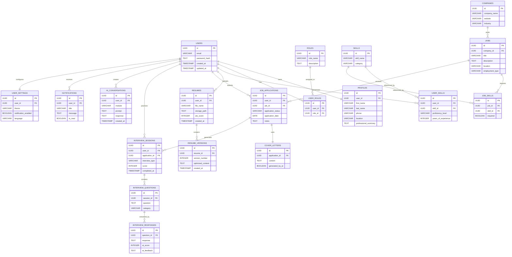

# AI Hub Platform

# Database Design

| Document | AI Hub Platform – Database Design |
|----------|-----------------------------------|
| Version | 1.0 |
| Status | Draft |
| Product | AI Hub Platform |
| Author | Abiola Akinselure |
| Reviewer | DaizSign Damilare Oloyede |
| Date | July 2026 |

---

# Table of Contents

1. Purpose
2. Database Objectives
3. Database Technology
4. Database Design Principles
5. Database Domains
6. Entity Relationship Diagram (ERD)
7. Database Schema *(Part 2)*
8. Relationships *(Part 2)*
9. Constraints *(Part 2)*
10. Indexing Strategy *(Part 2)*
11. Security Considerations *(Part 3)*
12. Backup & Recovery *(Part 3)*
13. Scalability Strategy *(Part 3)*
14. Future Enhancements *(Part 3)*
15. Related Documents *(Part 3)*
16. Revision History *(Part 3)*
17. Conclusion *(Part 3)*

---

# 1. Purpose

This document defines the logical database design for the AI Hub Platform.

The database serves as the foundation for storing, managing, and securing all application data required by the platform. It supports user authentication, career profile management, resume optimization, AI-powered interview preparation, job application tracking, and future platform capabilities.

The design emphasizes:

- Data integrity
- Scalability
- Performance
- Security
- Maintainability
- Extensibility

The schema has been designed to support the current MVP while allowing future expansion without requiring significant structural changes.

---

# 2. Database Objectives

The database has been designed to achieve the following objectives:

- Securely manage user identities and authentication.
- Store professional profiles and career information.
- Support multiple target career paths for each user.
- Maintain reusable skill definitions.
- Record user skill proficiency.
- Store uploaded resumes and optimized resume versions.
- Track job postings and applications.
- Generate and store AI-powered cover letters.
- Store interview practice sessions and AI evaluations.
- Record AI conversations across platform modules.
- Support notifications and user preferences.
- Provide a scalable data model for future SaaS growth.

---

# 3. Database Technology

| Component | Technology |
|------------|------------|
| Database Engine | PostgreSQL |
| Cloud Provider | Supabase |
| ORM | SQLAlchemy |
| Migration Tool | Alembic |
| Authentication | Supabase Auth |
| Storage | Supabase Storage |
| Database IDs | UUID |
| Security | Row-Level Security (RLS) |
| Connection Encryption | TLS |

---

# 4. Database Design Principles

The database follows modern relational database design principles.

## 4.1 Normalization

The schema follows Third Normal Form (3NF) to eliminate unnecessary duplication while maintaining efficient relationships.

Examples include:

- Master Skills table
- User Skills junction table
- Roles table
- User Roles junction table
- Job Skills junction table

---

## 4.2 UUID Primary Keys

Every major entity uses UUIDs instead of auto-incrementing integers to improve security and support distributed systems.

Example:

```
User
↓

UUID

550e8400-e29b-41d4-a716-446655440000
```

---

## 4.3 Referential Integrity

Foreign key constraints ensure that relationships remain valid throughout the system.

Examples:

- Every Resume belongs to one User.
- Every Job belongs to one Company.
- Every Cover Letter belongs to one Job Application.
- Every Interview Response belongs to one Interview Question.

---

## 4.4 Auditability

Major entities include audit fields such as:

- created_at
- updated_at

These support:

- Change tracking
- Troubleshooting
- Reporting
- Compliance

---

## 4.5 Scalability

The schema has been designed for:

- Large datasets
- Horizontal application scaling
- Future service separation
- Efficient indexing
- AI analytics

---

## 4.6 Security

Sensitive data is protected using:

- Row-Level Security (RLS)
- Encrypted database connections
- Password hashing
- Least-privilege access
- Secure authentication

---

# 5. Database Domains

To align with the modular monolith architecture, the database is organized into logical business domains.

---

## Identity Domain

Responsible for authentication and user identity.

Entities:

- Users
- Profiles
- Roles
- User Roles
- User Settings

Responsibilities:

- Authentication
- Authorization
- Personal information
- Career preferences
- User configuration

---

## Career Domain

Responsible for professional development.

Entities:

- Skills
- User Skills
- Resumes
- Resume Versions

Responsibilities:

- Resume management
- Career progression
- Skill tracking
- Resume optimization

---

## Recruitment Domain

Responsible for job search activities.

Entities:

- Companies
- Jobs
- Job Skills
- Job Applications
- Cover Letters

Responsibilities:

- Job tracking
- Company management
- AI cover letters
- ATS optimization

---

## AI Domain

Responsible for AI-powered functionality.

Entities:

- AI Conversations
- Interview Sessions
- Interview Questions
- Interview Responses

Responsibilities:

- AI chat history
- Interview coaching
- AI scoring
- Feedback generation
- Progress analytics

---

## Platform Domain

Responsible for platform-wide services.

Entities:

- Notifications

Responsibilities:

- System notifications
- User reminders
- Platform messaging

---

# 6. Entity Relationship Diagram (ERD)

The following Entity Relationship Diagram represents the logical data model for the AI Hub Platform.



---

## ERD Design Notes

The ERD has been designed around reusable entities and junction tables to eliminate duplication and improve scalability.

Key design decisions include:

- **Skills** are stored once and linked to users through `USER_SKILLS`.
- **Roles** are stored once and linked to users through `USER_ROLES`.
- **Job requirements** are linked through `JOB_SKILLS`, enabling AI-powered skill gap analysis.
- **Interview sessions** store individual questions and responses, allowing detailed AI feedback and performance analytics.
- **Resume versioning** preserves optimization history, making it possible to compare and restore previous resume versions.

This design aligns with the modular architecture defined in the **04_System_Architecture.md** document and provides a solid foundation for future service decomposition if the platform evolves beyond a modular monolith.

---
# 7. Database Schema

This section defines the logical schema for each entity in the AI Hub Platform.

Each table includes its primary purpose, key fields, and relationships with other entities.

---

# 7.1 Identity Domain

The Identity Domain manages authentication, authorization, user profiles, and platform preferences.

---

## USERS

Stores user authentication information.

| Field | Type | Description |
|---------|------|-------------|
| id | UUID (PK) | Unique user identifier |
| email | VARCHAR(255) | User email address |
| password_hash | TEXT | Encrypted password |
| created_at | TIMESTAMP | Record creation timestamp |
| updated_at | TIMESTAMP | Last update timestamp |

**Relationships**

- One User has one Profile.
- One User can have multiple Roles.
- One User can have multiple Skills.
- One User can upload multiple Resumes.
- One User can submit multiple Job Applications.
- One User can participate in multiple Interview Sessions.

---

## PROFILES

Stores professional information.

| Field | Type | Description |
|---------|------|-------------|
| id | UUID (PK) |
| user_id | UUID (FK) |
| first_name | VARCHAR |
| last_name | VARCHAR |
| phone | VARCHAR |
| location | VARCHAR |
| professional_summary | TEXT |
| created_at | TIMESTAMP |
| updated_at | TIMESTAMP |

---

## ROLES

Master table containing career paths.

Examples:

- IT Support Specialist
- System Administrator
- Network Administrator
- Cloud Engineer
- DevOps Engineer
- Cybersecurity Analyst
- Data Analyst

| Field | Type |
|---------|------|
| id | UUID (PK) |
| role_name | VARCHAR |
| description | TEXT |

---

## USER_ROLES

Many-to-Many relationship between Users and Roles.

| Field | Type |
|---------|------|
| id | UUID (PK) |
| user_id | UUID (FK) |
| role_id | UUID (FK) |
| created_at | TIMESTAMP |

A user may pursue multiple career paths simultaneously.

---

## USER_SETTINGS

Stores application preferences.

| Field | Type |
|---------|------|
| id | UUID (PK) |
| user_id | UUID (FK) |
| theme | VARCHAR |
| notification_enabled | BOOLEAN |
| language | VARCHAR |
| timezone | VARCHAR |

---

# 7.2 Career Domain

Responsible for career development and resume optimization.

---

## SKILLS

Master list of platform skills.

Examples:

- Linux
- Windows Server
- Active Directory
- Docker
- Kubernetes
- AWS
- Python
- SQL
- PowerShell

| Field | Type |
|---------|------|
| id | UUID (PK) |
| skill_name | VARCHAR |
| category | VARCHAR |
| created_at | TIMESTAMP |

---

## USER_SKILLS

Links users with their skills.

| Field | Type |
|---------|------|
| id | UUID (PK) |
| user_id | UUID (FK) |
| skill_id | UUID (FK) |
| proficiency_level | VARCHAR |
| years_of_experience | INTEGER |
| created_at | TIMESTAMP |

Example:

| User | Skill | Level |
|------|-------|--------|
| John | Linux | Advanced |
| John | Docker | Intermediate |

---

## RESUMES

Stores uploaded resumes.

| Field | Type |
|---------|------|
| id | UUID (PK) |
| user_id | UUID (FK) |
| file_name | VARCHAR |
| storage_path | TEXT |
| ats_score | INTEGER |
| upload_date | TIMESTAMP |
| created_at | TIMESTAMP |

---

## RESUME_VERSIONS

Maintains historical resume versions.

| Field | Type |
|---------|------|
| id | UUID (PK) |
| resume_id | UUID (FK) |
| version_number | INTEGER |
| optimized_content | TEXT |
| ats_score | INTEGER |
| generated_by_ai | BOOLEAN |
| created_at | TIMESTAMP |

Benefits include:

- Version history
- Resume rollback
- AI comparison
- ATS improvements

---

# 7.3 Recruitment Domain

Responsible for job searching and application tracking.

---

## COMPANIES

Stores employer information.

| Field | Type |
|---------|------|
| id | UUID (PK) |
| company_name | VARCHAR |
| website | VARCHAR |
| industry | VARCHAR |
| headquarters | VARCHAR |

---

## JOBS

Stores imported or manually created job postings.

| Field | Type |
|---------|------|
| id | UUID (PK) |
| company_id | UUID (FK) |
| title | VARCHAR |
| description | TEXT |
| location | VARCHAR |
| employment_type | VARCHAR |
| salary_range | VARCHAR |
| posted_date | DATE |

---

## JOB_SKILLS

Stores required skills for each job.

| Field | Type |
|---------|------|
| id | UUID (PK) |
| job_id | UUID (FK) |
| skill_id | UUID (FK) |
| required | BOOLEAN |

This enables future AI features such as:

- Skill Gap Analysis
- Resume Matching
- Career Recommendations
- Learning Suggestions

---

## JOB_APPLICATIONS

Tracks user applications.

| Field | Type |
|---------|------|
| id | UUID (PK) |
| user_id | UUID (FK) |
| job_id | UUID (FK) |
| application_status | VARCHAR |
| application_date | DATE |
| notes | TEXT |

Example statuses:

- Saved
- Applied
- Interview
- Assessment
- Offer
- Rejected
- Accepted

---

## COVER_LETTERS

Stores AI-generated cover letters.

| Field | Type |
|---------|------|
| id | UUID (PK) |
| application_id | UUID (FK) |
| content | TEXT |
| generated_by_ai | BOOLEAN |
| created_at | TIMESTAMP |

---

# 7.4 AI Domain

Responsible for AI-powered platform features.

---

## AI_CONVERSATIONS

Stores AI interactions.

| Field | Type |
|---------|------|
| id | UUID (PK) |
| user_id | UUID (FK) |
| module | VARCHAR |
| prompt | TEXT |
| response | TEXT |
| created_at | TIMESTAMP |

Possible modules include:

- Resume Optimizer
- ATS Analyzer
- Interview Coach
- Career Advisor
- Cover Letter Generator

---

## INTERVIEW_SESSIONS

Stores interview practice sessions.

| Field | Type |
|---------|------|
| id | UUID (PK) |
| user_id | UUID (FK) |
| application_id | UUID (FK) |
| interview_type | VARCHAR |
| score | INTEGER |
| completed_at | TIMESTAMP |

---

## INTERVIEW_QUESTIONS

Stores every interview question.

| Field | Type |
|---------|------|
| id | UUID (PK) |
| session_id | UUID (FK) |
| question | TEXT |
| category | VARCHAR |

Examples:

- Behavioural
- Technical
- HR
- Scenario
- Troubleshooting

---

## INTERVIEW_RESPONSES

Stores user answers and AI evaluations.

| Field | Type |
|---------|------|
| id | UUID (PK) |
| question_id | UUID (FK) |
| response | TEXT |
| ai_score | INTEGER |
| ai_feedback | TEXT |
| created_at | TIMESTAMP |

This allows detailed interview analytics over time.

---

# 7.5 Platform Domain

---

## NOTIFICATIONS

Stores notifications and reminders.

| Field | Type |
|---------|------|
| id | UUID (PK) |
| user_id | UUID (FK) |
| title | VARCHAR |
| message | TEXT |
| is_read | BOOLEAN |
| created_at | TIMESTAMP |

---

# 8. Relationships

The following relationships exist within the database.

| Parent Entity | Child Entity | Relationship |
|---------------|--------------|--------------|
| USERS | PROFILES | One-to-One |
| USERS | USER_ROLES | One-to-Many |
| ROLES | USER_ROLES | One-to-Many |
| USERS | USER_SKILLS | One-to-Many |
| SKILLS | USER_SKILLS | One-to-Many |
| USERS | RESUMES | One-to-Many |
| RESUMES | RESUME_VERSIONS | One-to-Many |
| COMPANIES | JOBS | One-to-Many |
| JOBS | JOB_SKILLS | One-to-Many |
| SKILLS | JOB_SKILLS | One-to-Many |
| USERS | JOB_APPLICATIONS | One-to-Many |
| JOBS | JOB_APPLICATIONS | One-to-Many |
| JOB_APPLICATIONS | COVER_LETTERS | One-to-One |
| USERS | INTERVIEW_SESSIONS | One-to-Many |
| JOB_APPLICATIONS | INTERVIEW_SESSIONS | One-to-Many |
| INTERVIEW_SESSIONS | INTERVIEW_QUESTIONS | One-to-Many |
| INTERVIEW_QUESTIONS | INTERVIEW_RESPONSES | One-to-Many |
| USERS | AI_CONVERSATIONS | One-to-Many |
| USERS | NOTIFICATIONS | One-to-Many |
| USERS | USER_SETTINGS | One-to-One |

---

# 9. Constraints

The database enforces the following constraints:

## Primary Keys

Every table uses a UUID Primary Key.

---

## Foreign Keys

Foreign keys enforce referential integrity between related tables.

---

## Unique Constraints

Examples include:

- Email addresses
- Role names
- Skill names
- Resume version numbers (per resume)

---

## NOT NULL Constraints

Critical fields such as:

- email
- password_hash
- user_id
- company_id
- job_id
- created_at

must always contain values.

---

## Cascade Rules

Appropriate cascade behavior will be configured to:

- Prevent orphan records.
- Preserve historical application data.
- Protect AI-generated content.

---

# 10. Indexing Strategy

Indexes improve query performance across frequently accessed tables.

## Single-Column Indexes

Indexes will be created on:

- email
- company_name
- role_name
- skill_name
- created_at
- application_status
- completed_at

---

## Composite Indexes

Examples include:

| Table | Composite Index |
|---------|----------------|
| USER_SKILLS | (user_id, skill_id) |
| USER_ROLES | (user_id, role_id) |
| JOB_SKILLS | (job_id, skill_id) |
| JOB_APPLICATIONS | (user_id, application_status) |
| RESUME_VERSIONS | (resume_id, version_number) |

Composite indexes will support efficient filtering, reporting, and AI recommendation queries.

---
# 11. Security Considerations

Security is a foundational principle of the AI Hub Platform. The database is designed to protect user information, AI-generated content, and sensitive career data while complying with modern security best practices.

---

## 11.1 Authentication

Authentication is managed using **Supabase Authentication**.

Features include:

- Email and password authentication
- Secure password hashing
- JWT token authentication
- Session management
- Password reset workflows
- Email verification

---

## 11.2 Authorization

The platform implements **Role-Based Access Control (RBAC)** to ensure users can only access authorized resources.

Examples include:

- Users can only view their own resumes.
- Users can only edit their own profile.
- Users cannot access another user's interview history.
- Administrative functions are restricted to authorized personnel.

---

## 11.3 Row-Level Security (RLS)

Supabase Row-Level Security (RLS) policies will be enabled on all user-owned tables.

Protected tables include:

- USERS
- PROFILES
- USER_SKILLS
- RESUMES
- RESUME_VERSIONS
- JOB_APPLICATIONS
- COVER_LETTERS
- INTERVIEW_SESSIONS
- AI_CONVERSATIONS
- NOTIFICATIONS
- USER_SETTINGS

Example policy:

```sql
Users may only access records where user_id = auth.uid()
```

---

## 11.4 Data Encryption

The platform protects data using multiple layers of encryption.

### Data in Transit

- TLS encryption
- HTTPS communication
- Secure API connections

### Data at Rest

Sensitive information stored within PostgreSQL and Supabase Storage is encrypted using managed cloud encryption services.

---

## 11.5 Password Security

Passwords are never stored in plain text.

Authentication uses:

- Secure password hashing
- Salted password storage
- Secure authentication tokens

---

## 11.6 API Security

Backend APIs implement:

- JWT validation
- Request validation
- Input sanitization
- Rate limiting
- Authentication middleware
- Authorization middleware

---

## 11.7 Audit Logging

Important user activities will be logged, including:

- Account creation
- Login events
- Resume uploads
- Resume optimization
- Job applications
- AI interview sessions
- AI conversation history

Audit logs support:

- Security investigations
- Compliance
- Troubleshooting
- User activity monitoring

---

## 11.8 Backup Security

Backups are:

- Encrypted
- Automatically generated
- Stored securely
- Regularly verified

---

# 12. Backup & Recovery

Reliable backup and recovery procedures ensure business continuity.

---

## Backup Strategy

The platform supports:

- Daily automated backups
- Incremental backups
- Point-in-Time Recovery (PITR)
- Backup validation
- Secure backup storage

---

## Recovery Objectives

| Objective | Target |
|-----------|--------|
| Recovery Point Objective (RPO) | Less than 24 hours |
| Recovery Time Objective (RTO) | Less than 4 hours |

---

## Disaster Recovery

Recovery procedures include:

- Database restoration
- Storage restoration
- Infrastructure redeployment
- Configuration recovery
- Backup verification

---

# 13. Scalability Strategy

The database has been designed to support significant platform growth without major architectural redesign.

---

## Vertical Scaling

Initially, the platform can scale by increasing database resources such as:

- CPU
- Memory
- Storage

---

## Horizontal Scaling

As usage grows, the architecture supports:

- Read replicas
- Connection pooling
- Load balancing
- Distributed application servers

---

## Database Optimization

Future optimization strategies include:

- Query optimization
- Materialized views
- Database partitioning
- Intelligent indexing
- Connection pooling

---

## AI Data Management

AI-generated content may become one of the largest datasets within the platform.

Strategies include:

- Archiving historical AI conversations
- Compressing large AI responses
- Separating analytics workloads
- Dedicated AI reporting databases

---

## Service Separation

The database design aligns with the modular monolith architecture documented in **04_System_Architecture.md**.

As the platform evolves, domains can be separated into independent services.

Potential future services include:

- Identity Service
- Career Service
- Recruitment Service
- AI Service
- Notification Service
- Analytics Service

Because domain boundaries are already established, future service extraction can occur with minimal database redesign.

---

# 14. Future Enhancements

The current schema supports the Minimum Viable Product (MVP).

Future releases may introduce additional entities and capabilities.

Potential future tables include:

## Identity

- Organizations
- Teams
- Recruiters

---

## Career

- Certifications
- Learning Paths
- Portfolio Projects
- Work Experience Templates

---

## Recruitment

- Saved Jobs
- Interview Invitations
- Recruiter Feedback
- Employer Profiles

---

## AI

- AI Career Coach
- Personalized Learning Recommendations
- AI Resume Scoring History
- AI Skill Gap Analysis
- AI Career Roadmaps

---

## Platform

- Billing
- Subscription Plans
- Payments
- User Activity Logs
- Analytics Dashboard

---

# 15. Related Documents

This document should be read alongside the following project documentation:

| Document | Purpose |
|-----------|---------|
| 01_Product_Vision_Document.md | Defines the long-term vision of the platform |
| 02_Product_Requirements_Document.md | Functional and business requirements |
| 03_User_Journey.md | User workflows and experience |
| 04_System_Architecture.md | System architecture and component design |
| 06_AWS_Cloud_Architecture.md | Cloud infrastructure design |
| 07_API_Design.md | API specifications and endpoints |
| 08_Implementation_Roadmap.md | Development phases and milestones |

Together, these documents provide a complete technical and product blueprint for the AI Hub Platform.

---

# 16. Revision History

| Version | Date | Author | Description |
|----------|------|--------|-------------|
| 1.0 | July 2026 | Abiola Akinselure | Initial database design document |

---

# 17. Conclusion

The AI Hub Platform database has been designed to provide a secure, scalable, and maintainable foundation for an AI-powered career development platform.

The schema follows modern relational database principles by applying normalization, reusable reference tables, junction tables, strong referential integrity, UUID primary keys, and comprehensive security controls. These design decisions reduce redundancy, improve data consistency, and support future platform growth.

By organizing the database into distinct business domains—**Identity, Career, Recruitment, AI, and Platform**—the design mirrors the modular monolith architecture established in the System Architecture document. This alignment simplifies application development today while providing a clear migration path toward service-oriented or microservice-based architectures in the future.

The inclusion of reusable entities such as **Roles**, **Skills**, **User Skills**, and **Job Skills** enables advanced AI capabilities including:

- ATS Resume Matching
- Skill Gap Analysis
- Personalized Career Recommendations
- Interview Performance Analytics
- Intelligent Learning Suggestions

Leveraging PostgreSQL, Supabase, Row-Level Security (RLS), SQLAlchemy, and Alembic provides a modern and reliable data platform that balances developer productivity with enterprise-grade security and operational resilience.

This database design serves as the authoritative data model for the AI Hub Platform and establishes a strong foundation for the API layer, cloud infrastructure, AI workflows, and future product enhancements.

